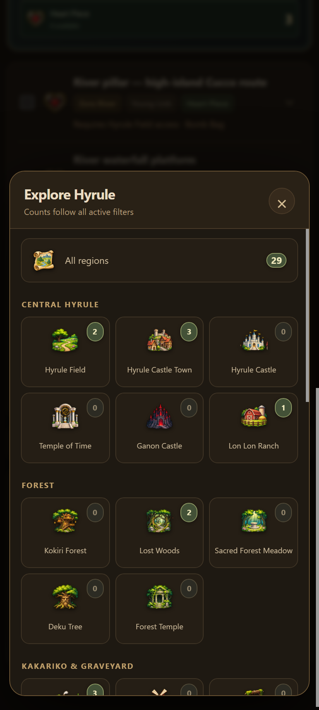
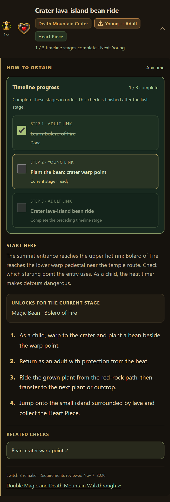

# Hyrule Atlas


An offline Android completion tracker and guide with an illustrated inventory, local progress storage, and filters for timeline, item type and region. This is an unofficial fan companion with original generated artwork.

## Download

Install the APK from the [v1.6 release](https://github.com/drizztdourden08/hyrule-atlas/releases/tag/v1.6). Android 11 or newer is required.

Install updates over the existing app to retain local progress. The package is `com.hyruleatlas.local`; updates must use the same signing key. JSON export/import provides a portable progress backup.

## Features

- 272 active checklist entries, including 36 Heart Pieces and 100 Gold Skulltulas.
- Numbered guides with equipment requirements, location context and source links.
- Explicit dungeon reward and story events. Dungeon equipment never automatically awards a medallion.
- Separate frog rewards; one current exchange per trade or prize sequence; exact bean-planting prerequisites.
- Ordered Young/Adult stages with one active stage at a time, including routes that return to a timeline more than once.
- Region badges that follow all active filters and a collapsible summary of remaining checks.
- Illustrated inventory with hearts, magic capacity, dungeon rewards, equipment and collection totals.
- Persistent local saves, Undo, backup export/import and an optional keep-screen-awake switch.
- Bundled icons and guide data; the app needs no network permission. Source links open in the phone's browser.



## Progress and timeline stages

Mark a dungeon event after receiving its Spiritual Stone or Medallion. The inventory offers the same reward checkboxes. Boss Heart Containers are separate pickups; mark those only if you collected the heart. Light Arrows require the five adult temple rewards, and the defense fairy requires castle access and Golden Gauntlets.

With both timelines selected, expand a route to check its numbered timeline stages. Only the current stage can advance. With Young or Adult selected, its main-row checkbox acts on the current eligible stage; a route waiting on the other timeline stays hidden. A three-stage route such as learning Bolero, planting a bean as Young Link, then riding it as Adult Link remains one collectible and counts complete only after the final stage.

Trade and linked prize chains show only their next unfinished exchange, even with **Include locked** enabled. Use **Completed** to review earlier exchanges. Region badges count the currently filtered list; the collapsible remaining summary also includes checks waiting on later stages.

Existing whole-item checkmarks remain complete after the update. New adult dungeon rewards are not guessed from equipment or Heart Containers. Record rewards you already received in the inventory; unambiguous existing story evidence is retained. Version 6 JSON backups include partial stages, and **Export pre-update backup** preserves the original private save from before this upgrade.



## Project layout

| Path | Purpose |
|---|---|
| `android/src/` | Native Activity, local storage bridge, export and keep-screen-awake support |
| `android/assets/` | Bundled HTML, JavaScript, styles, guide database and generated icons |
| `android/res/` | Android launcher icon resources |
| `authoring/` | Editable guide records, source index and guide-generation scripts |
| `data/guide-database.json` | Readable generated guide database |
| `tests/` | Headless browser checks for filters, dependencies, saves, inventory and settings |
| `docs/` | Checklist audit, coverage crosswalk and previews |
| `build.ps1` | Windows Android SDK build and signing script |

## Edit and validate

Node.js 22 or newer is required. There are no npm dependencies to install.

```powershell
npm run guide:build
npm test
npm run test:ui
```

Edit the guide records in `authoring/guide-*.mjs`, editorial adjustments in `authoring/refine-guide.mjs`, explicit prerequisites in `authoring/requirements-v6.mjs`, and ordered stages in `authoring/timeline-stages.mjs`, then regenerate. Preserve stable record IDs, milestone keys and stage keys so saved checkmarks keep their meaning. Direct UI edits belong in `android/assets/`; changes to the inline base HTML also belong in `authoring/pre-guide-index.html`.

The UI checks use a local HTTP server, synthetic test saves and headless Chrome. On Windows they use Chrome's standard installation path; set `CHROME_PATH` if it is installed elsewhere. Generated test profiles, screenshots and build outputs are ignored by Git.

## Build the APK

Use PowerShell 7, JDK 21, Android SDK platform 36, platform-tools, and build-tools 36.0.0.

The existing signing keystore stays outside this repository. Configure it in your current shell:

```powershell
$env:ANDROID_SDK_ROOT = 'C:\Android'
$env:ATLAS_KEYSTORE_PATH = 'C:\private\hyrule-atlas-signing.p12'
$env:ATLAS_KEYSTORE_PASSWORD = Read-Host 'Keystore password' -MaskInput
.\build.ps1
```

`JAVA_HOME` is used when set; otherwise the script finds `javac.exe` on `PATH`. The key alias defaults to `atlas` and can be changed with `ATLAS_KEY_ALIAS`. The signed, verified APK is written to `outputs/Hyrule-Atlas.apk`.

To install over an existing copy:

```powershell
adb install -r outputs/Hyrule-Atlas.apk
```

## Guide coverage

See the [v1.6 requirements audit](docs/Requirements-v1.6.md), [complete prerequisite and stage table](docs/Requirements.csv), and [36-piece coverage crosswalk](docs/Heart-piece-coverage.csv). The [v1.5 checklist audit](docs/Checklist-audit-notes.md) records the earlier coverage review. Source references are also linked inside each guide entry. The guide is based on published remake walkthroughs; source disagreements remain documented in the affected entries.
